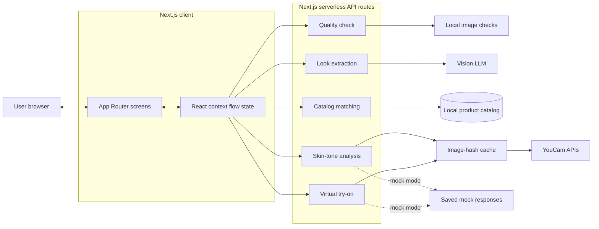

# Look DNA

Look DNA turns a fashion or beauty inspiration image into a complete, purchasable look tailored to the user's skin tone and budget. Users can preview the matched look on their own selfie before deciding what to buy.

The project is being built for the **YouCam API Skin AI & eCommerce VTO Hackathon**, in the **eCommerce VTO** track.

> **Project status:** Full six-screen flow and all five API routes are live at https://look-dna.vercel.app with real YouCam and Gemini calls. The catalog (`data/catalog.json`) holds 71 real products from 8 Indian brands, pulled from the brands' public Shopify product feeds with their own photos, INR prices and buy links.

## Product Flow

1. Upload a fashion or beauty inspiration image.
2. Upload a selfie and select a budget.
3. Extract the inspiration image's Look DNA, including garment, cosmetic, color, and style attributes.
4. Analyze the user's skin tone and adapt suitable shades.
5. Match similar products from the local catalog while respecting the budget.
6. Preview the result with virtual try-on.
7. Review the cart, total price, match scores, and product alternatives.

Every catalog match is presented as **similar, not identical** and includes a match score.

## Stack

- Next.js App Router
- React and TypeScript
- Tailwind CSS
- Next.js serverless API routes
- YouCam Skin Tone Analysis and Virtual Try-On APIs
- Vision LLM for structured inspiration-image extraction
- Vercel deployment

The application is intentionally account-free and database-free. Flow state lives in React context on the client, while API credentials remain on the server.

## Screens

| Route | Purpose |
| --- | --- |
| `/` | Upload an inspiration image |
| `/selfie` | Add a selfie, choose a budget, and handle quality feedback |
| `/dna` | Review the extracted Look DNA |
| `/adapt` | View skin-tone analysis and adapted shades |
| `/tryon` | Preview and compare the virtual try-on result |
| `/cart` | Review products, budget usage, and swaps |

## API Routes

| Endpoint | Purpose |
| --- | --- |
| `POST /api/quality` | Check selfie brightness and blur locally |
| `POST /api/skin-tone` | Analyze skin tone with YouCam |
| `POST /api/extract` | Extract structured look attributes with a vision LLM |
| `POST /api/match` | Deterministically match catalog products within budget |
| `POST /api/tryon` | Run clothes and makeup virtual try-on |

## Architecture

### System Architecture



The browser owns navigation, previews, loading states, and the current flow data. It sends only the inputs required by each server route. Next.js API routes keep provider credentials private, validate responses, and return the shared typed contract to the client.

### Request Flow

1. The inspiration image is sent to `/api/extract`, where the vision LLM returns strict structured JSON.
2. The selfie is checked by `/api/quality` before any paid provider call is made.
3. `/api/skin-tone` resolves the user's tone through the cache, YouCam, or saved mocks.
4. `/api/match` uses extracted items, skin tone, budget, and `catalog.json` to choose products deterministically.
5. `/api/tryon` runs clothes and makeup VTO through the cache, with mock responses available during frontend development.
6. The client stores each result in React context and presents the final products and total in the cart.

### Component Responsibilities

| Layer | Responsibilities |
| --- | --- |
| App Router screens | Capture images and budget, display progress, comparisons, products, and errors |
| React context | Hold temporary flow state across the six screens |
| API routes | Validate input, orchestrate providers, and keep credentials server-side |
| `lib/llm.ts` | Call the vision model and enforce structured extraction output |
| `lib/youcam.ts` | Implement the documented YouCam asynchronous task flow |
| `lib/matching.ts` | Score catalog similarity, adapt shades, and enforce the budget |
| `lib/cache.ts` | Reuse YouCam results by image hash to conserve API units |
| `lib/types.ts` | Define the shared client/server data contract |
| `data/catalog.json` | Provide the only products eligible for matching |
| `data/mocks/` | Provide deterministic YouCam responses in mock mode |

### Project Structure

```text
app/
  page.tsx
  selfie/
  dna/
  adapt/
  tryon/
  cart/
  components/
  api/
    quality/route.ts
    skin-tone/route.ts
    extract/route.ts
    match/route.ts
    tryon/route.ts
lib/
  types.ts
  youcam.ts
  llm.ts
  matching.ts
  cache.ts
data/
  catalog.json
  mocks/
```

YouCam responses will be cached by image hash to conserve API units. Setting `MOCK_YOUCAM=1` will make YouCam-backed routes use saved responses from `data/mocks/`, allowing frontend development without consuming API credits.

## Core Data Model

The shared flow contract connects extracted inspiration items, the user's skin tone and budget, catalog matches, and the final total.

```json
{
  "items": [
    {
      "category": "top",
      "color": "#C8A2C8",
      "style": ["oversized", "knit"]
    },
    {
      "category": "lipstick",
      "color": "#B5485D",
      "finish": "matte"
    }
  ],
  "userTone": {
    "hex": "#C68E6B",
    "undertone": "warm"
  },
  "budget": 3000,
  "matches": [
    {
      "category": "lipstick",
      "productId": "lip-014",
      "adaptedColor": "#A8473F",
      "reason": "A warmer red suits your warm undertone",
      "score": 0.86,
      "price": 499
    }
  ],
  "total": 2850
}
```

Catalog prices are stored in INR. Matching and budget decisions are deterministic application logic, not LLM decisions.

## YouCam APIs used

| API | Endpoint | Used for |
| --- | --- | --- |
| AI Skin Tone Analysis | `/s2s/v2.0/task/skin-tone-analysis` | Skin tone hex from the selfie; the undertone (warm, cool, neutral) is derived from it in Lab colour space |
| AI Clothes Virtual Try-On | `/s2s/v2.0/task/cloth-v4` | One matched garment (the first clothing item in the look) on the selfie, using the catalog product photo as the garment |
| AI Makeup Virtual Try-On | `/s2s/v2.0/task/makeup-vto` | The adapted lip shade, applied on top of the clothes result |

All three use YouCam's async task flow (upload file, create task, poll until done). Results are cached by image hash so the same photo never spends units twice. If chaining clothes then makeup fails, the app shows both results side by side. Eyeshadow and blush are matched and shown in the cart but not rendered on the selfie (the PRD's documented fallback).

## Results

Results from the 10-image test go here. Run `npm run test:live` (below) and paste in `test/results.md`.

| Metric | Target | Result |
| --- | --- | --- |
| Look items matched to a catalog product | 80% or more | _pending_ |
| Total look cost vs budget | Under budget in 10 of 10 runs | _pending_ |
| Time from upload to try-on result | Under 60 seconds | _pending_ |
| Poor-quality selfies caught by the quality gate | All test cases | _pending_ |

## Development

```bash
npm install
npm run dev
```

Create `.env.local` for server-side API configuration. Never expose YouCam or LLM credentials through client-side environment variables. To run against saved YouCam responses:

```dotenv
MOCK_YOUCAM=1   # YouCam routes return data/mocks/*.json
MOCK_LLM=1      # /api/extract returns data/mocks/extract.json
```

For live extraction set `GEMINI_API_KEY` (server-side only). `/api/extract` sends the inspiration image to Gemini (`gemini-flash-latest` by default, override with `GEMINI_MODEL`) with a strict JSON schema, validates the reply and retries once. If only `ANTHROPIC_API_KEY` is set, Claude is used instead.

### How matching works (`lib/matching.ts`)

- **Adaptation (F4):** makeup shades are nudged in LCh colour space toward coral/orange-red for warm undertones or blue-red/berry for cool ones (max 18° hue shift), and deepened for deeper skin tones. Each shade gets a one-line reason.
- **Matching (F5):** score = 0.75 × colour closeness (CIE76 ΔE) + 0.25 × style/finish tag overlap, capped at 98%. Top 5 candidates per item.
- **Budget (F6):** start with the best match per item; while over budget, swap the priciest piece for its next cheaper candidate; if nothing cheaper exists, drop the least essential piece (blush, eyes, outerwear first).
- **Swap:** the cart re-calls `/api/match` with the swapped product excluded.

### Setup

1. `npm install`
2. Copy `.env.example` to `.env.local` and set `YOUCAM_API_KEY` and `GEMINI_API_KEY`. Remove `MOCK_YOUCAM` and `MOCK_LLM` for live calls.
3. Optional: set `UPSTASH_REDIS_REST_URL` and `UPSTASH_REDIS_REST_TOKEN` so the cache survives serverless cold starts (recommended for the demo).
4. `npm run dev`, then open http://localhost:3000 on a phone-sized window.

On Vercel, set the same variables in Project Settings → Environment Variables.

### Catalog

`data/catalog.csv` lists 71 real products (tops, bottoms, dresses, outerwear, lipsticks, eyeshadows, blushes) from Bonkers Corner, Style Union, Kazo, The Label Life, Forever New, Salt Attire, SUGAR Cosmetics and Swiss Beauty, taken from each store's public `products.json` feed on 1 Nov 2026. Each lipstick, eyeshadow and blush shade is its own row with the colour sampled from its swatch photo; garment colours come from the product name where it states one, otherwise from the photo. Prices and stock change, so re-check before the demo.


Edit `data/catalog.csv` (one row per product), then run `npm run catalog:import`. It checks every row, makes sure each image downloads and is a JPEG or PNG of at least 300px, samples the colour of clothing images when the `color` column is blank, and writes `data/catalog.json`. Add `-- --dry` to check without writing. Column details are at the top of `scripts/import-catalog.mjs`.

### 10-image test

Put images in `test/` (see `test/README.md`), then:

```bash
DISABLE_RATE_LIMIT=1 npm run build && DISABLE_RATE_LIMIT=1 npm start
```

```bash
npm run test:live
```

`BASE_URL`, `BUDGET` and `SKIP_TRYON=1` are optional. The run writes the metrics table to `test/results.md`. `DISABLE_RATE_LIMIT` is ignored on Vercel.

Before pushing changes, run:

```bash
npm run build
```

## Implementation Principles

- Keep all provider API keys server-side.
- Follow the official YouCam API endpoints and asynchronous task flow exactly.
- Cache each YouCam result by image hash.
- Keep product matching and budget logic deterministic.
- Use cosmetic language only; do not make medical or skin-condition claims.
- Build mobile-first screens with loading and error states for every API call.
- Prefer the documented fallbacks over expanding scope when an integration is unreliable.

## Team Ownership

| Area | Owner |
| --- | --- |
| Backend: `app/api/`, `lib/`, and `data/mocks/` | Utpal |
| Frontend: screens, `app/components/`, and `data/catalog.json` | Ruchi |
| Shared contract: `lib/types.ts` | Both owners |

Changes to the shared data contract should be agreed on by both owners.

## Documentation

- [`CLAUDE.md`](CLAUDE.md) contains the engineering brief and contribution constraints.
- [`Look_DNA_PRD_Work_Split.pdf`](Look_DNA_PRD_Work_Split.pdf) contains the product requirements and work split.
- [`docs/SUBMISSION.md`](docs/SUBMISSION.md) contains the Devpost text, video script and submission checklist.
