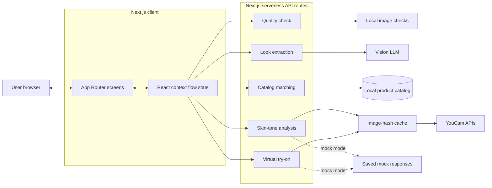

# Look DNA

Look DNA turns a fashion or beauty inspiration image into a complete, purchasable look tailored to the user's skin tone and budget. Users can preview the matched look on their own selfie before deciding what to buy.

The project is being built for the **YouCam API Skin AI & eCommerce VTO Hackathon**, in the **eCommerce VTO** track.

> **Project status:** In progress. Done: quality, skin-tone and try-on API routes, the app shell (layout, Tailwind, flow context), and screens 2 (`/selfie`) and 5 (`/tryon`). Still to build: `/api/extract`, `/api/match`, `data/catalog.json`, and screens 1, 3, 4 and 6.

## Product Flow

1. Upload a fashion or beauty inspiration image.
2. Upload a selfie and select a budget.
3. Extract the inspiration image's Look DNA, including garment, cosmetic, color, and style attributes.
4. Analyze the user's skin tone and adapt suitable shades.
5. Match similar products from the local catalog while respecting the budget.
6. Preview the result with virtual try-on.
7. Review the cart, total price, match scores, and product alternatives.

Every catalog match is presented as **similar, not identical** and includes a match score.

## Planned Stack

- Next.js App Router
- React and TypeScript
- Tailwind CSS
- Next.js serverless API routes
- YouCam Skin Tone Analysis and Virtual Try-On APIs
- Vision LLM for structured inspiration-image extraction
- Vercel deployment

The application is intentionally account-free and database-free. Flow state lives in React context on the client, while API credentials remain on the server.

## Planned Screens

| Route | Purpose |
| --- | --- |
| `/` | Upload an inspiration image |
| `/selfie` | Add a selfie, choose a budget, and handle quality feedback |
| `/dna` | Review the extracted Look DNA |
| `/adapt` | View skin-tone analysis and adapted shades |
| `/tryon` | Preview and compare the virtual try-on result |
| `/cart` | Review products, budget usage, and swaps |

## Planned API Routes

| Endpoint | Purpose |
| --- | --- |
| `POST /api/quality` | Check selfie brightness and blur locally |
| `POST /api/skin-tone` | Analyze skin tone with YouCam |
| `POST /api/extract` | Extract structured look attributes with a vision LLM |
| `POST /api/match` | Deterministically match catalog products within budget |
| `POST /api/tryon` | Run clothes and makeup virtual try-on |

## Architecture

### System Architecture



The browser owns navigation, previews, loading states, and the current flow data. It sends only the inputs required by each server route. Next.js API routes keep provider credentials private, validate responses, and return the shared typed contract to the client.

### Request Flow

1. The inspiration image is sent to `/api/extract`, where the vision LLM returns strict structured JSON.
2. The selfie is checked by `/api/quality` before any paid provider call is made.
3. `/api/skin-tone` resolves the user's tone through the cache, YouCam, or saved mocks.
4. `/api/match` uses extracted items, skin tone, budget, and `catalog.json` to choose products deterministically.
5. `/api/tryon` runs clothes and makeup VTO through the cache, with mock responses available during frontend development.
6. The client stores each result in React context and presents the final products and total in the cart.

### Component Responsibilities

| Layer | Responsibilities |
| --- | --- |
| App Router screens | Capture images and budget, display progress, comparisons, products, and errors |
| React context | Hold temporary flow state across the six screens |
| API routes | Validate input, orchestrate providers, and keep credentials server-side |
| `lib/llm.ts` | Call the vision model and enforce structured extraction output |
| `lib/youcam.ts` | Implement the documented YouCam asynchronous task flow |
| `lib/matching.ts` | Score catalog similarity, adapt shades, and enforce the budget |
| `lib/cache.ts` | Reuse YouCam results by image hash to conserve API units |
| `lib/types.ts` | Define the shared client/server data contract |
| `data/catalog.json` | Provide the only products eligible for matching |
| `data/mocks/` | Provide deterministic YouCam responses in mock mode |

### Planned Project Structure

```text
app/
  page.tsx
  selfie/
  dna/
  adapt/
  tryon/
  cart/
  components/
  api/
    quality/route.ts
    skin-tone/route.ts
    extract/route.ts
    match/route.ts
    tryon/route.ts
lib/
  types.ts
  youcam.ts
  llm.ts
  matching.ts
  cache.ts
data/
  catalog.json
  mocks/
```

YouCam responses will be cached by image hash to conserve API units. Setting `MOCK_YOUCAM=1` will make YouCam-backed routes use saved responses from `data/mocks/`, allowing frontend development without consuming API credits.

## Core Data Model

The shared flow contract connects extracted inspiration items, the user's skin tone and budget, catalog matches, and the final total.

```json
{
  "items": [
    {
      "category": "top",
      "color": "#C8A2C8",
      "style": ["oversized", "knit"]
    },
    {
      "category": "lipstick",
      "color": "#B5485D",
      "finish": "matte"
    }
  ],
  "userTone": {
    "hex": "#C68E6B",
    "undertone": "warm"
  },
  "budget": 3000,
  "matches": [
    {
      "category": "lipstick",
      "productId": "lip-014",
      "adaptedColor": "#A8473F",
      "reason": "A warmer red suits your warm undertone",
      "score": 0.86,
      "price": 499
    }
  ],
  "total": 2850
}
```

Catalog prices are stored in INR. Matching and budget decisions are deterministic application logic, not LLM decisions.

## Development

Once the Next.js application scaffold is present:

```bash
npm install
npm run dev
```

Create `.env.local` for server-side API configuration. Never expose YouCam or LLM credentials through client-side environment variables. To run against saved YouCam responses:

```dotenv
MOCK_YOUCAM=1
```

Before pushing changes, run:

```bash
npm run build
```

## Implementation Principles

- Keep all provider API keys server-side.
- Follow the official YouCam API endpoints and asynchronous task flow exactly.
- Cache each YouCam result by image hash.
- Keep product matching and budget logic deterministic.
- Use cosmetic language only; do not make medical or skin-condition claims.
- Build mobile-first screens with loading and error states for every API call.
- Prefer the documented fallbacks over expanding scope when an integration is unreliable.

## Team Ownership

| Area | Owner |
| --- | --- |
| Backend: `app/api/`, `lib/`, and `data/mocks/` | Utpal |
| Frontend: screens, `app/components/`, and `data/catalog.json` | Ruchi |
| Shared contract: `lib/types.ts` | Both owners |

Changes to the shared data contract should be agreed on by both owners.

## Documentation

- [`CLAUDE.md`](CLAUDE.md) contains the engineering brief and contribution constraints.
- [`Look_DNA_PRD_Work_Split.pdf`](Look_DNA_PRD_Work_Split.pdf) contains the product requirements and work split.
